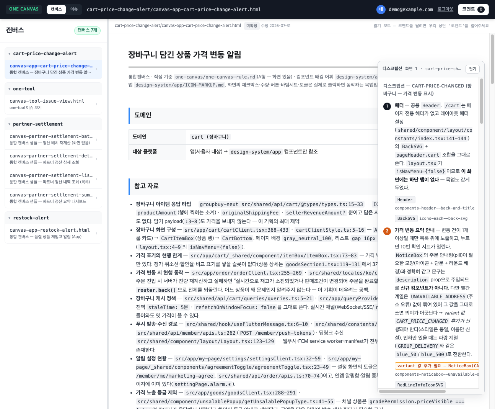
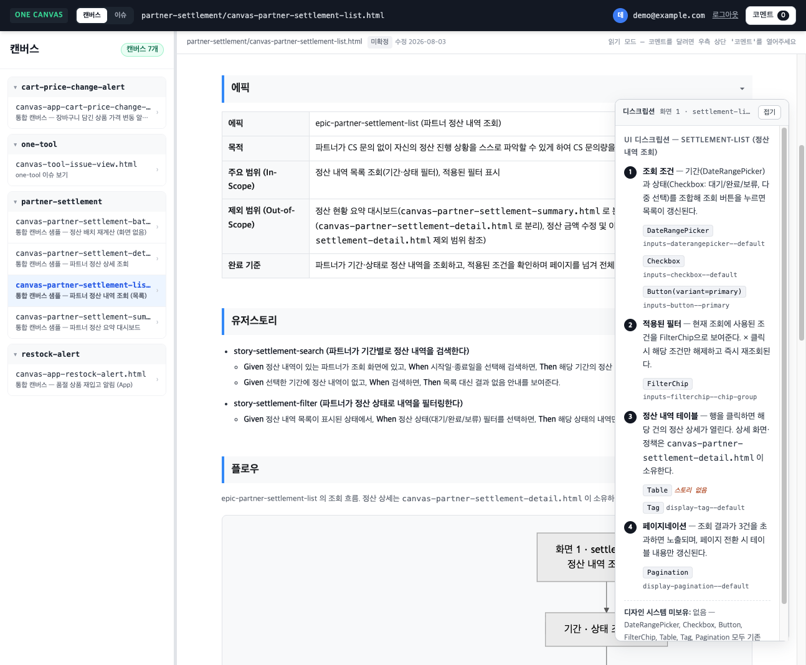
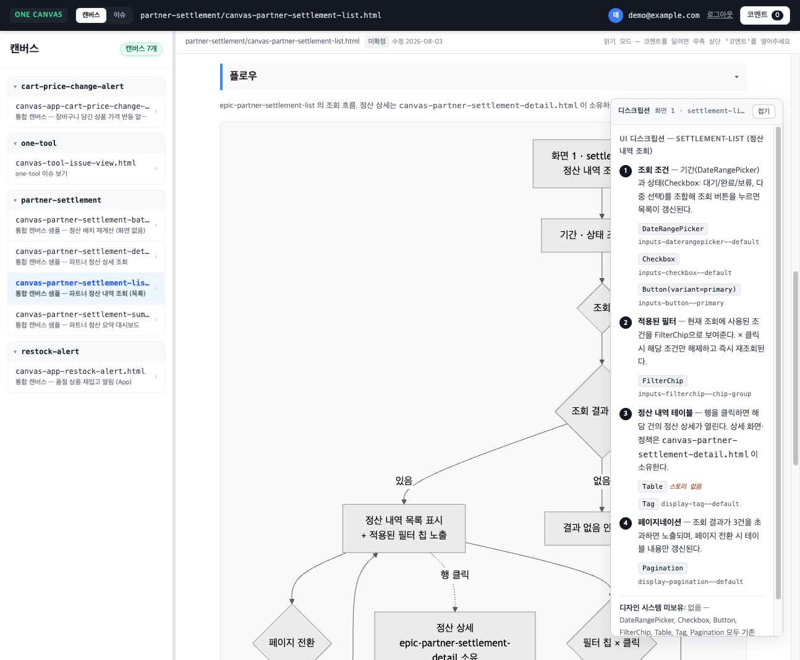
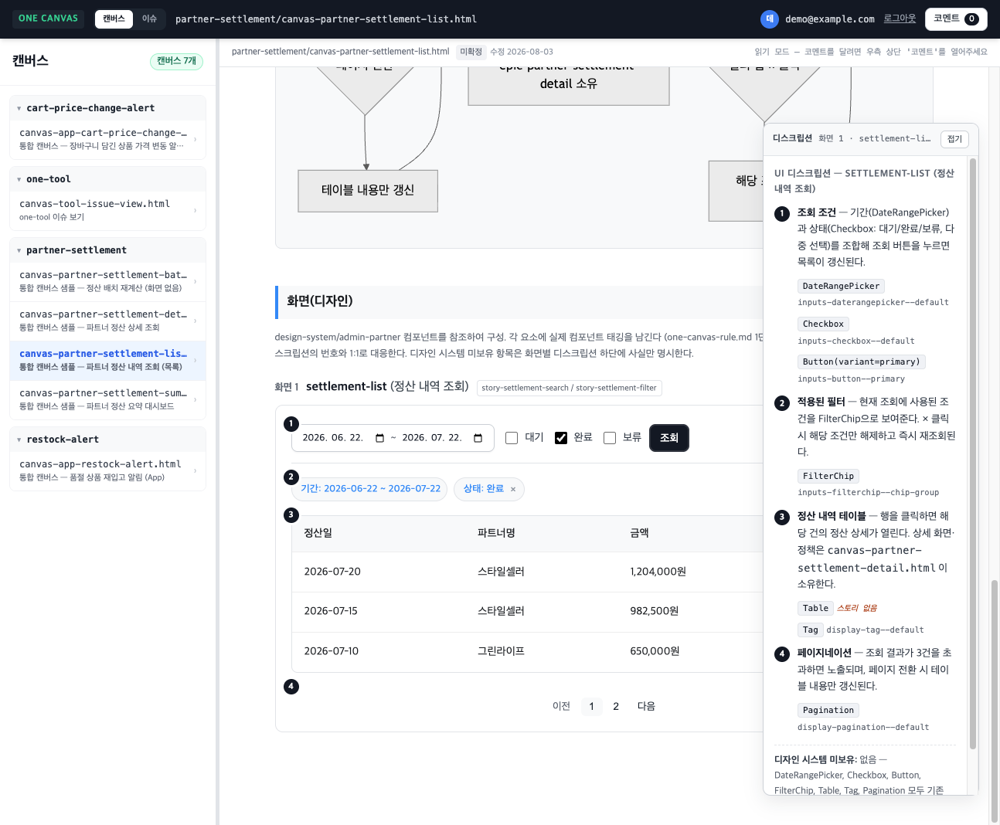
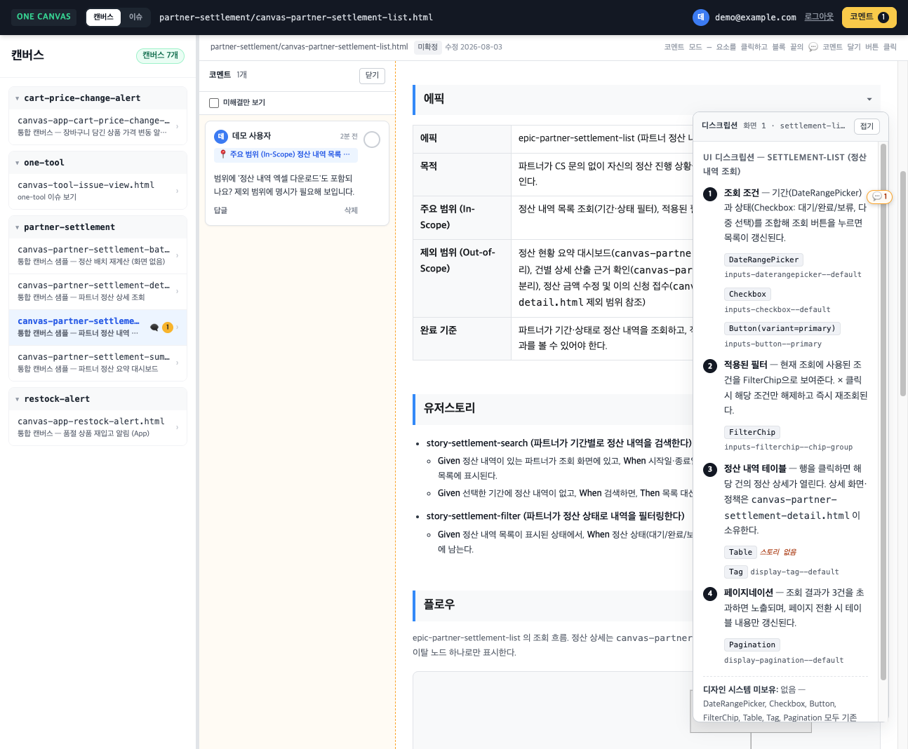
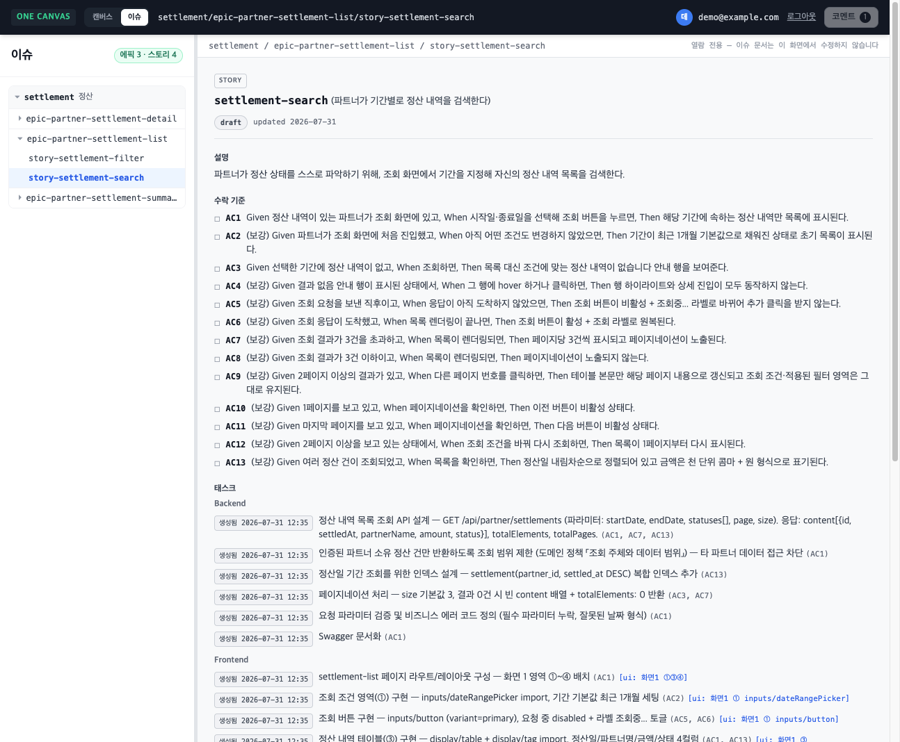

# one-canvas

**기획과 디자인을 HTML 문서 한 장(통합캔버스)으로 합쳐 관리하고, 이를 개발 이슈까지 이어 주는 워크플로 샘플입니다.**
사람과 AI 에이전트가 같은 문서를 읽고 같은 기준으로 일하는 것을 목표로 합니다.

| 구성 요소 | 한 줄 설명 |
|---|---|
| **one-canvas** | 기획·디자인을 한 장에 담은 통합캔버스 문서와 작성 규칙 |
| **one-tool** | 통합캔버스와 애자일 이슈를 브라우저에서 보고 블록 단위로 코멘트를 남기는 웹앱 |
| **agile-issue** | 캔버스를 근거로 만드는 에픽·스토리·태스크 문서와 작성 규칙 |

> 처음 보신다면 스크린샷이 포함된 [상세 소개 문서](docs/one-canvas-and-one-tool.md)부터 읽어 보세요.



---

## 프로젝트 목적

코딩은 이미 상당 부분 에이전트가 대신 수행할 수 있는 영역이 되었다. 개발 시간이 단축되면서 병목은 자연스럽게 앞단으로 이동한다 — 신규 기능 요청은 계속 쌓이는데, 그만큼의 시간을 이제는 기획에 써야 하는 상황이다.

문제는 기획·디자인이 코딩보다 훨씬 사고와 소통에 시간이 많이 들고, 한 번 수정되면 개발 전반에 파급력이 크다는 점이다. 게다가 기획과 디자인이 별도 산출물·별도 프로세스로 분리되어 있으면 그 자체로 소통 비용이 늘어나고, 에이전트가 코드를 작성할 때도 대화 세션과 토큰 소모가 커진다.

**one-canvas(통합 캔버스)** 는 이 문제를 풀기 위해, 기획과 디자인의 결과물을 하나의 캔버스로 통합해 관리하는 것을 목표로 한다.

### 요구사항

1. **최신성** — 캔버스에 나타난 기획과 디자인은 항상 최신 상태를 반영해야 한다.
2. **가독성** — 사람뿐 아니라 에이전트도 문서를 읽고 바로 작업에 활용할 수 있어야 한다.

---

## 통합캔버스 한눈에 보기

통합캔버스 하나(`canvas-*.html`)는 위에서 아래로 다음 순서로 구성됩니다.

| 순서 | 항목 | 내용 |
|---|---|---|
| 1 | 도메인 | 어떤 업무 영역의 기획인가 |
| 2 | 에픽 | 목적 · 범위 · 제외 범위 · 완료 기준 |
| 3 | 유저스토리 | Given-When-Then 시나리오 |
| 4 | 플로우 | 처리 흐름과 분기 다이어그램 |
| 5 | 화면(디자인) | 실제로 동작하는 화면 목업 |
| 6 | 디스크립션 | 화면 번호별 설명과 사용 컴포넌트 |

핵심 원칙은 세 가지입니다.

- **지어내지 않고 질문한다** — 캔버스는 뒤따르는 이슈의 단일 출처입니다. 근거 없는 한 줄이 에픽·스토리·테스트로 번집니다.
- **캔버스 1개 = 에픽 1개** — 한 기획 건에서 캔버스가 여럿 나오는 것이 정상입니다.
- **디자인 시스템에 있는 컴포넌트만 태깅한다** — 없는 것은 「디자인 시스템 미보유」로 따로 적습니다.

자세한 규칙은 [`one-canvas/one-canvas-rule.md`](one-canvas/one-canvas-rule.md)에 있습니다.

| 에픽 | 플로우 | 화면 |
|---|---|---|
|  |  |  |

---

## one-tool 한눈에 보기

Spring Boot(WebFlux) + MySQL로 만든 웹앱입니다. 레포의 캔버스·이슈 파일을 폴더에서 읽어 보여줍니다.

- **캔버스 모드** — 기획 건별 캔버스 목록, 본문 열람, 확정/미확정 배지
- **코멘트** — 본문 블록을 클릭해 의견을 남기고, 답글과 해결 표시로 정리. 미해결 개수는 목록에 표시
- **이슈 모드** — 도메인 → 에픽 → 스토리 트리로 이슈를 열람(수락 기준·태스크 포함, 열람 전용)
- **이어서 보기** — 모드별로 마지막에 본 문서를 기억

| 코멘트 | 이슈 상세 |
|---|---|
|  |  |

---

## 전체 흐름 속 위치

```
기획자: 통합캔버스 초안 작성 (대기획/소기획)
   ▼
디자이너: one-tool에서 열람·코멘트, AI와 대화하며 검수·수정
   ▼
agile-issue: 캔버스를 근거로 에픽·스토리(수락 기준·태스크·테스트) 생성
   ▼
개발: 이슈 + 캔버스 화면 + 디자인 시스템(Storybook) 컴포넌트로 구현
```

수정이 발생하면 **영향 범위 파악 → 디자인 시스템 반영 → 이슈 수정 → 개발 수정** 순으로 전파됩니다.
도식으로 보려면 [업무 프로세스 문서](docs/one-canvas-process.md)를 참고하세요.
기획 배경은 기획 문서(`에이전틱 개발 업무 단축을 위한 기획-디자인시스템 통합 계획.md`)를 참고하세요.

---

## 레포 구성

이 저장소(one-canvas) 하위에 관련 산출물을 함께 관리한다.

```
.
├── one-canvas/     기획디자인 통합 문서
│   ├── one-canvas-rule.md      통합캔버스 작성 규칙
│   └── sample/                 샘플 캔버스 (정산, 장바구니 가격 변동 알림, 재입고 알림, one-tool 이슈 보기)
├── design-system/  UI 문서화 툴(Storybook)  — 이 샘플 레포에는 포함하지 않음
├── agile-issue/    애자일 이슈 관리
│   ├── agile-issue-rule.md     이슈 작성 규칙
│   └── sample/                 샘플 이슈 (settlement)
├── one-tool/       업무툴 (캔버스·이슈 열람, 코멘트 웹앱)
└── docs/           상세 소개 문서와 화면 캡처
```

---

## 빠르게 실행해 보기

준비물: JDK 21, MySQL 8 (빈 데이터베이스 하나).

one-tool은 목록을 만들 때 `sample/` 폴더를 제외합니다. 이 레포에는 샘플만 있으므로, 샘플을 한 단계 위로 복사한 폴더를 지정해야 목록이 보입니다. DB 비밀번호(`DB_PASSWORD`)에는 기본값이 없어서 주지 않으면 시작 단계에서 실패합니다.

```bash
# 1) 샘플을 한 단계 위로 복사
mkdir -p /tmp/demo/one-canvas /tmp/demo/agile-issue
cp -R one-canvas/sample/*  /tmp/demo/one-canvas/
cp -R agile-issue/sample/* /tmp/demo/agile-issue/

# 2) 일회용 MySQL
docker run -d --name onetool-mysql -e MYSQL_ROOT_PASSWORD=changeme \
  -e MYSQL_DATABASE=one-tool -p 3307:3306 mysql:8.3 --character-set-server=utf8mb4

# 3) 실행
cd one-tool && ./gradlew bootJar -x test
java -jar build/libs/one-tool-0.0.1-SNAPSHOT.jar \
  --server.port=8090 \
  --spring.datasource.url='jdbc:mysql://127.0.0.1:3307/one-tool?characterEncoding=utf8' \
  --spring.datasource.username=root --spring.datasource.password=changeme \
  --one-canvas.root-path=/tmp/demo/one-canvas \
  --agile-issue.root-path=/tmp/demo/agile-issue
```

`http://localhost:8090` 에서 회원가입 후 로그인하면 됩니다. 단계별 설명과 화면은 [상세 소개 문서](docs/one-canvas-and-one-tool.md#7-직접-실행해-보기)를 참고하세요.

---

## 문서 안내

| 문서 | 내용 |
|---|---|
| [docs/one-canvas-and-one-tool.md](docs/one-canvas-and-one-tool.md) | 처음 보는 사람을 위한 상세 소개 (스크린샷 포함) |
| [docs/one-canvas-process.md](docs/one-canvas-process.md) | 업무 프로세스 도식 (Mermaid) |
| [one-canvas/one-canvas-rule.md](one-canvas/one-canvas-rule.md) | 통합캔버스 작성 규칙 |
| [agile-issue/agile-issue-rule.md](agile-issue/agile-issue-rule.md) | 애자일 이슈 작성 규칙 |
| [one-tool/ss-tool-rule.md](one-tool/ss-tool-rule.md) | 업무툴 규칙 문서 |
