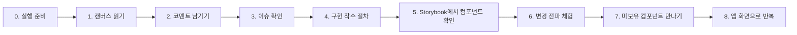
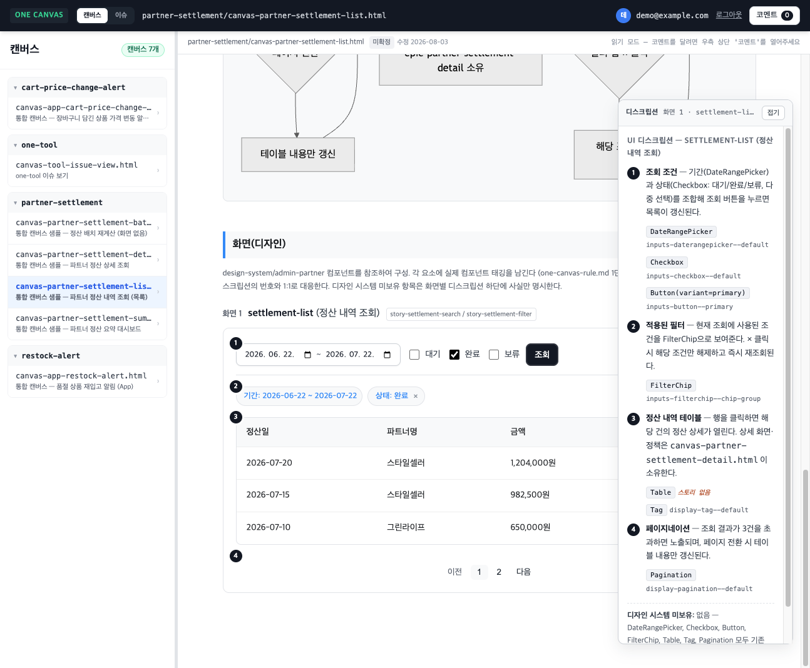
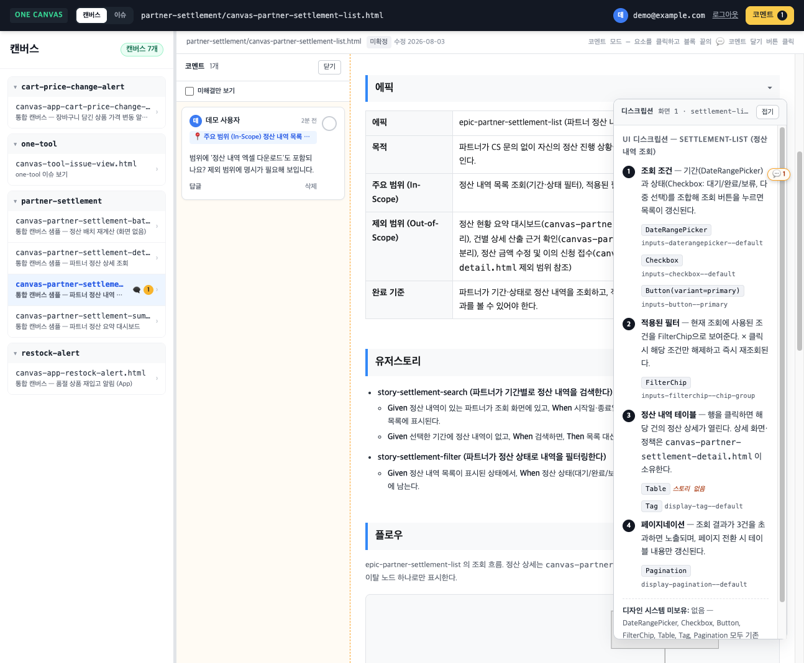
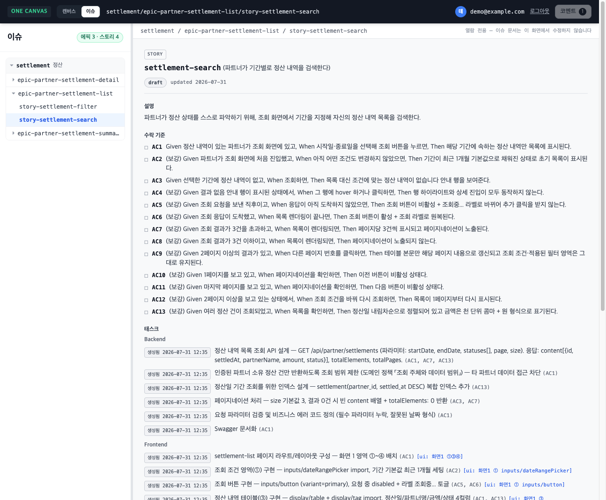
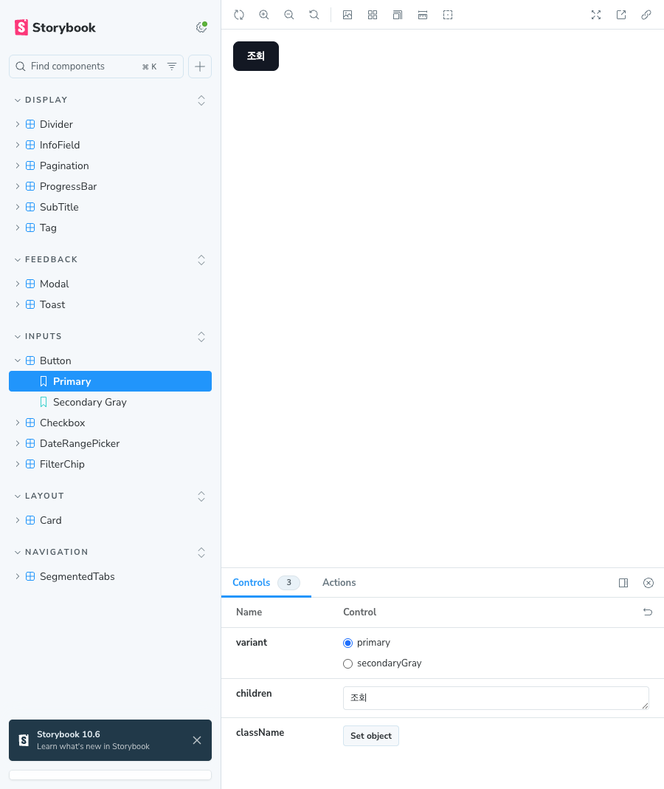
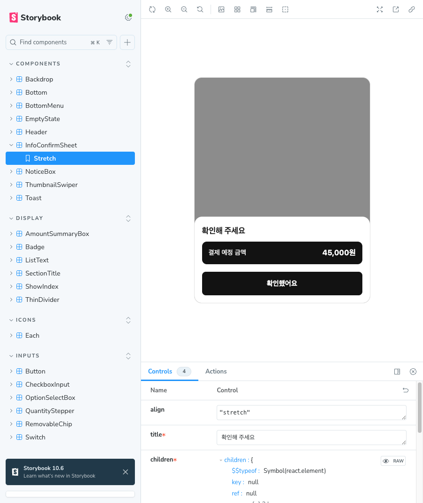

# 직접 따라 해 보는 one-canvas 업무 플로우

이 문서는 레포를 내려받은 사람이 **기획 → 리뷰 → 이슈 → 구현 착수**의 흐름을 샘플로 직접 체험하도록 안내합니다.
개념이 낯설다면 먼저 [소개 문서](one-canvas-and-one-tool.md)와 [업무 프로세스 도식](one-canvas-process.md)을 읽어 보세요.

**소요 시간**: 약 30분 · **예제**: 파트너 정산 내역 조회(`partner-settlement`)



## 0. 실행 준비

터미널 두 개가 필요합니다. 준비물은 JDK 21, Node.js 18 이상, Docker(MySQL용)입니다.

**터미널 A — one-tool** (자세한 설명은 [소개 문서 7장](one-canvas-and-one-tool.md#7-직접-실행해-보기))

```bash
mkdir -p /tmp/demo/one-canvas /tmp/demo/agile-issue
cp -R one-canvas/sample/*  /tmp/demo/one-canvas/
cp -R agile-issue/sample/* /tmp/demo/agile-issue/

docker run -d --name onetool-mysql -e MYSQL_ROOT_PASSWORD=changeme \
  -e MYSQL_DATABASE=one-tool -p 3307:3306 mysql:8.3 --character-set-server=utf8mb4

cd one-tool && ./gradlew bootJar -x test
java -jar build/libs/one-tool-0.0.1-SNAPSHOT.jar --server.port=8090 \
  --spring.datasource.url='jdbc:mysql://127.0.0.1:3307/one-tool?characterEncoding=utf8' \
  --spring.datasource.username=root --spring.datasource.password=changeme \
  --one-canvas.root-path=/tmp/demo/one-canvas \
  --agile-issue.root-path=/tmp/demo/agile-issue
```

**터미널 B — Storybook (디자인 시스템)**

```bash
cd design-system/admin-partner
npm install
npm run storybook
```

| 주소 | 무엇 |
|---|---|
| http://localhost:8090 | one-tool (회원가입 후 로그인) |
| http://localhost:6008 | Storybook (어드민·파트너용, 1~7단계) |
| http://localhost:6007 | Storybook (앱용, 8단계에서 사용 — `cd design-system/app && npm install && npm run storybook`) |

> **왜 `/tmp/demo`로 복사하나요?** one-tool은 `sample/` 폴더를 목록에서 제외합니다. 샘플을 한 단계 위로 복사한 사본을 읽게 하는 것이고, 6단계에서는 이 사본을 수정합니다. 원본 `sample/`은 바뀌지 않습니다.

## 1. 캔버스 읽기

one-tool에서 **캔버스 모드 → `partner-settlement` → `canvas-partner-settlement-list.html`** 을 엽니다.
위에서 아래로 훑으며 아래를 찾아보세요.

| 찾을 것 | 확인할 점 |
|---|---|
| 에픽 | 목적, 주요 범위(In), **제외 범위(Out)**, 완료 기준. 제외 범위에 요약·상세가 다른 캔버스로 분리되어 있다고 적혀 있습니다 |
| 유저스토리 | Given-When-Then 2개(검색, 필터) |
| 플로우 | 정산 상세는 다른 캔버스 소유라 이탈 노드 하나로만 표시됩니다 |
| 화면 | ①~④ 번호가 붙은 동작 목업. 체크박스와 조회 버튼을 직접 눌러 보세요 |
| 디스크립션 | 오른쪽 패널. 번호별 설명과 **사용 컴포넌트·story id** |



**확인 질문**: 화면 ①(조회 조건)이 쓰는 컴포넌트는 무엇이고, 그 story id는 무엇인가요? (정답은 5단계 표)

## 2. 코멘트 남기기

우측 상단 **코멘트**를 켜고, 에픽 표의 「제외 범위」 행을 클릭한 뒤 **💬 코멘트 달기**를 눌러 의견을 남겨 보세요.
예: "정산 내역 엑셀 다운로드는 범위 밖인가요?"

- 코멘트는 캔버스 파일이 아니라 one-tool DB에 저장됩니다. 원본을 건드리지 않는 리뷰 방식입니다.
- 코멘트가 달린 캔버스에는 왼쪽 목록에 미해결 개수가 표시됩니다.
- 질문이 해소되면 코멘트를 **해결** 처리합니다.



> 실제 업무에서는 이 코멘트를 근거로 디자이너가 AI와 대화하며 캔버스를 고칩니다. 근거가 없는 항목을 지어내지 않고 질문으로 남기는 것이 이 방식의 핵심 규칙입니다([규칙 문서](../one-canvas/one-canvas-rule.md)의 「형식을 지킬 수 없으면 질문한다」).

## 3. 이슈 확인

상단 **이슈**로 전환해 `settlement → epic-partner-settlement-list → story-settlement-search` 를 엽니다.

- **수락 기준(AC)** 이 번호(AC1…)로 나열됩니다.
- **태스크**의 끝에 `[ui: 화면1 ① inputs/checkbox]` 같은 태그가 붙어 있습니다. "캔버스 화면 1의 ① 영역을, 이 컴포넌트로 구현하라"는 뜻입니다.
- 어느 캔버스에서 나온 이슈인지는 에픽 파일의 `캔버스:` 줄로 연결됩니다.



## 4. 구현 착수 절차

이슈 하나만 읽고 구현하면 배치와 컴포넌트를 지어내게 됩니다. 규칙([`agile-issue-rule.md`](../agile-issue/agile-issue-rule.md))이 정한 순서는 다음과 같습니다.

1. **스토리** `index.md` — 기능 정책, AC, 태스크, 열린 질문
2. **에픽** `index.md` 「참조 자료」 — 화면 번호로 **앵커** 찾기 (화면 1 → `#screen-list`)
3. **캔버스 화면 열기** — `canvas-partner-settlement-list.html#screen-list`. 배치·카피·컴포넌트 태깅 확인
4. **디자인 시스템에서 import** — 새로 만들지 않기

직접 해 보기: `agile-issue/sample/settlement/epic-partner-settlement-list/index.md` 의 「화면 목록」 표에서 앵커를 찾고, 캔버스 HTML에서 `screen-list` 영역 안의 `<!-- component: ... -->` 주석을 찾아보세요. 주석이 story 경로까지 알려 줍니다.

```html
<!-- component: Button(variant=primary) | story: Inputs/Button (src/components/inputs/button/button.stories.tsx) -->
```

> AI 에이전트에게 구현을 시킨다면 같은 순서를 프롬프트로 주면 됩니다. 예시는 규칙 문서의 「착수 프롬프트」 절에 있습니다.

## 5. Storybook에서 컴포넌트 확인

화면 1이 태깅한 컴포넌트를 Storybook에서 확인합니다. 주소는 `http://localhost:6008/?path=/story/<story id>` 입니다.

| 화면 영역 | 컴포넌트 | story id | 열기 |
|---|---|---|---|
| ① 기간 | DateRangePicker | `inputs-daterangepicker--default` | [열기](http://localhost:6008/?path=/story/inputs-daterangepicker--default) |
| ① 상태 | Checkbox | `inputs-checkbox--default` | [열기](http://localhost:6008/?path=/story/inputs-checkbox--default) |
| ① 조회 버튼 | Button (primary) | `inputs-button--primary` | [열기](http://localhost:6008/?path=/story/inputs-button--primary) |
| ② 적용된 필터 | FilterChip | `inputs-filterchip--chip-group` | [열기](http://localhost:6008/?path=/story/inputs-filterchip--chip-group) |
| ③ 테이블 | Table | 스토리 없음 | `src/components/display/table/table.tsx` 직접 확인 |
| ③ 상태 표시 | Tag | `display-tag--default` | [열기](http://localhost:6008/?path=/story/display-tag--default) |
| ④ 페이지네이션 | Pagination | `display-pagination--default` | [열기](http://localhost:6008/?path=/story/display-pagination--default) |

화면 하단의 Controls 패널에서 props를 바꿔 보면서 어떤 값을 받는지 확인할 수 있습니다.



**직접 해 보기**: 위 컴포넌트들만 조합해 정산 목록 화면(①~④)을 `design-system/admin-partner/src/` 밖의 새 파일(예: 본인 앱의 `SettlementList.tsx`)에서 구성해 보세요. 새 컴포넌트를 만들 필요가 없다는 것이 이 방식의 목적입니다. AI에게 맡기는 경우에도 "design-system에 있는 컴포넌트만 import"하도록 지시합니다.

## 6. 변경 전파 체험

기획이 바뀌면 **영향 범위 파악 → 디자인 시스템 반영 → 이슈 수정 → 개발 수정** 순서로 전파합니다.
시나리오: "정산 상태에 **취소**를 추가해 달라"는 요청이 왔습니다.

| 단계 | 할 일 | 어디를 보나 |
|---|---|---|
| ① 영향 범위 파악 | 상태가 등장하는 곳을 찾는다 | 캔버스의 상태 체크박스(대기/완료/보류), 유저스토리, 디스크립션 ①, 이슈의 AC·태스크 |
| ② 캔버스 수정 | `/tmp/demo/one-canvas/partner-settlement/canvas-partner-settlement-list.html` 에서 체크박스와 유저스토리 문구에 "취소"를 추가 | 저장 후 one-tool을 새로고침하면 반영됩니다 |
| ③ 디자인 시스템 반영 | 취소를 표시할 Tag 색상이 필요한지 판단한다. 필요하면 `Tag`의 `tone`에 값을 추가하고 스토리를 갱신 | Storybook의 `display-tag--multiple` |
| ④ 이슈 수정 | 해당 스토리의 AC와 태스크에 취소 상태를 반영 | `/tmp/demo/agile-issue/…/story-settlement-filter/index.md` |
| ⑤ 개발 수정 | 바뀐 이슈와 캔버스를 기준으로 구현을 고친다 | 4단계 절차 반복 |

핵심은 **캔버스가 먼저 바뀌고, 나머지가 그것을 따라간다**는 점입니다. 이슈나 코드를 먼저 고치면 캔버스가 낡아져 "최신성" 요구사항이 깨집니다.

## 7. 미보유 컴포넌트 만나기

`partner-settlement/canvas-partner-settlement-summary.html`(정산 요약 대시보드)을 열어 **TrendSparkline** 을 찾아보세요.
캔버스에 "신규 필요 — design-system에 없음", story는 "없음(디자인 시스템 미보유)"으로 표시되어 있습니다. Storybook에서도 검색되지 않습니다.

이때의 올바른 행동:

- 비슷하게 생긴 컴포넌트를 **임의로 새로 만들지 않는다.**
- 그 화면 영역은 **구현을 보류**하고, 만들지 공용으로 편입할지를 **질문**한다.
- 나머지 영역(이미 있는 컴포넌트)은 정상적으로 구현한다.

"없는 것을 있는 것처럼 태깅하지 않고, 있는 것을 새로 만들지 않는다"가 캔버스와 디자인 시스템 사이의 약속입니다.

## 8. 앱 화면으로 반복하기 (`design-system/app`)

같은 흐름을 **앱(사용자 대상) 캔버스**로 한 번 더 해 봅니다. 앱 쪽은 디자인 시스템이 다르고(포트 **6007**), 캔버스에 태깅하는 이름의 목록이 자동 생성 문서로 따로 있습니다.

```bash
cd design-system/app
npm install
npm run storybook      # http://localhost:6007
```

1. one-tool에서 `cart-price-change-alert/canvas-app-cart-price-change-alert.html`(장바구니 가격 변동 알림)을 엽니다. 화면이 여러 개이고, 체크박스·수량·바텀시트·토글이 실제로 동작하는 목업입니다.
2. **[`design-system/app/COMPONENT-CATALOG.md`](../design-system/app/COMPONENT-CATALOG.md)** 를 엽니다. 앱 캔버스는 이 문서의 **`story id` 열**이 단일 출처입니다(어드민·파트너처럼 `*.stories.tsx`의 title을 grep하지 않습니다).
3. 캔버스의 디스크립션에서 컴포넌트를 찾아 story id를 카탈로그와 대조하고, `http://localhost:6007/?path=/story/<story id>` 로 엽니다.

| 캔버스의 컴포넌트 | story id | 확인 포인트 |
|---|---|---|
| `Header` | `components-header--back-and-title` | 뒤로가기 아이콘 + 제목 |
| `NoticeBox(variant=GROUP_DELIVERY)` | `components-noticebox--group-delivery` | 파랑 계열 안내 |
| `NoticeBox(variant=UNAVAILABLE_ADDRESS)` | `components-noticebox--unavailable-address` | 빨강 계열 안내 |
| `Toast` | `components-toast--default` | 하단 토스트 |
| `BackSVG` 등 아이콘 | `icons-each--back-svg` | 아이콘은 `Icons/Each` 한 곳에 모여 있음 |



> 모든 스토리는 폭 375px 휴대폰 프레임 안에 그려집니다. 화면 하단에 붙는 `Bottom`, `BottomMenu`, `InfoConfirmSheet`가 실제 앱과 같은 위치에 보입니다.

**미보유 항목 4분류 체험.** 장바구니 캔버스의 「디자인 시스템 미보유」 줄을 읽고, 각 항목이 어느 분류인지 맞춰 보세요.

| 분류 | 예 | 구현 시 행동 |
|---|---|---|
| `신규 필요` | `PriceChangeAmount` (담은 가격 → 현재가 비교 표기) | **그 화면 영역만 보류**하고 질문. Storybook에서 검색해도 없습니다 |
| `variant 값 추가 필요` | `NoticeBox`의 `CART_PRICE_CHANGED` | 컴포넌트는 있으므로 정상 구현하되, variant 값 추가가 선행됨. `NoticeBox` 스토리에는 세 variant(`CTA`, `UNAVAILABLE_ADDRESS`, `GROUP_DELIVERY`)뿐입니다 |
| `참조 전용(page-local)` | 특정 페이지 안에서만 쓰는 컴포넌트 | 새로 만들지 말고 참조만 |
| `공용화 필요` | `AgreementToggle` | 공용으로 승격하는 작업이 선행돼야 재사용 가능 |

화면 영역까지 보류하는 것은 `신규 필요` 한 가지뿐입니다(규칙: [`agile-issue-rule.md`](../agile-issue/agile-issue-rule.md)). 이 샘플 Storybook에는 위 미보유 항목들이 **일부러 들어 있지 않습니다**([목록](../design-system/app/design-system-app.md)).

## 정리

```bash
# 종료
# 터미널 A/B에서 Ctrl+C 후
docker rm -f onetool-mysql
rm -rf /tmp/demo
```

## 다음 단계

- 샘플을 참고해 **내 기획 건의 캔버스**를 `one-canvas/<기획-건>/canvas-*.html`로 만들어 보세요. 규칙은 [`one-canvas-rule.md`](../one-canvas/one-canvas-rule.md)입니다.
- 이 레포의 `design-system/admin-partner`와 `design-system/app`은 샘플용 최소 구성입니다. 실제로 쓸 때는 팀의 컴포넌트로 교체하고, 캔버스의 태깅이 그 컴포넌트의 실제 경로·story를 가리키게 유지하세요.
