# one-canvas와 one-tool 소개

> 이 문서는 one-canvas와 one-tool을 **처음 보는 사람**을 위한 안내서입니다.
> 화면 캡처는 이 레포의 `sample/` 캔버스·이슈를 one-tool에 띄워 직접 찍은 것입니다. 화면에 보이는 사용자(`demo@example.com`)와 코멘트는 데모용입니다.

## 목차

1. [한 줄 요약](#1-한-줄-요약)
2. [왜 만들었나](#2-왜-만들었나)
3. [one-canvas(통합캔버스)란](#3-one-canvas통합캔버스란)
4. [one-tool이란](#4-one-tool이란)
5. [전체 흐름: 기획에서 개발까지](#5-전체-흐름-기획에서-개발까지)
6. [레포 구성](#6-레포-구성)
7. [직접 실행해 보기](#7-직접-실행해-보기)

---

## 1. 한 줄 요약

| | 무엇인가 | 비유 |
|---|---|---|
| **one-canvas** | 기획과 디자인을 **HTML 문서 한 장**에 합친 "통합캔버스" 문서와 그 작성 규칙 | 설계도 |
| **one-tool** | one-canvas 문서와 애자일 이슈를 **브라우저에서 보고 코멘트를 남기는** 사내 협업 웹앱 | 설계도를 펼쳐 놓고 같이 보는 회의실 |

---

## 2. 왜 만들었나

코딩은 이미 상당 부분 에이전트(AI)가 대신할 수 있게 되었습니다. 개발이 빨라지면 병목은 앞단으로 옮겨 갑니다. 신규 기능 요청은 계속 쌓이는데, 이제 그만큼의 시간을 **기획과 디자인**에 써야 합니다.

기획·디자인은 코딩보다 사고와 소통에 시간이 많이 듭니다. 한 번 바뀌면 개발 전체에 파급됩니다. 게다가 기획서와 디자인이 따로 관리되면 소통 비용이 늘고, 에이전트가 코드를 짤 때도 대화와 토큰이 더 듭니다.

one-canvas는 기획과 디자인 결과물을 **하나의 캔버스로 통합**해서 이 문제를 풉니다. 요구사항은 두 가지입니다.

1. **최신성** — 캔버스의 기획·디자인은 항상 최신 상태여야 한다.
2. **가독성** — 사람뿐 아니라 에이전트도 읽고 바로 작업에 쓸 수 있어야 한다.

---

## 3. one-canvas(통합캔버스)란

통합캔버스는 `one-canvas/<기획-건>/canvas-*.html` 형태의 **HTML 파일**입니다. 작성 규칙은 [`one-canvas/one-canvas-rule.md`](../one-canvas/one-canvas-rule.md)에 있습니다.

### 3-1. 문서 구성 (화면이 있는 경우, A유형)

문서 하나는 아래 순서로 구성됩니다. 화면이 없는 경우(예: 배치 작업)는 B유형으로 화면 관련 항목을 뺍니다.

| 순서 | 소제목 | 담는 내용 |
|---|---|---|
| 1 | 도메인 | 이 기획이 속한 업무 영역 (예: settlement = 정산) |
| 2 | 에픽 | 목적 · 범위(In) · 제외 범위(Out) · 완료 기준 |
| 3 | 유저스토리 | Given-When-Then 시나리오 |
| 4 | 플로우 | 처리 흐름과 분기를 그린 다이어그램 |
| 5 | 화면(디자인) | 실제로 동작하는 화면 목업 |
| 6 | 디스크립션 | 화면 번호별 설명과 사용 컴포넌트 |

참고할 Figma·엑셀 같은 외부 자료가 있으면 도메인 바로 다음에 「참고 자료」를 둡니다.

요구사항(회의록, 티켓, 채팅 등)은 원문 그대로 나열하지 않습니다. 받는 즉시 **에픽과 유저스토리로 분류**해서 적습니다.

### 3-2. 실제 모습

아래는 이 레포의 샘플 캔버스 「파트너 정산 내역 조회」입니다. 문서 하나를 위에서 아래로 훑으면 기획부터 화면까지 이어서 볼 수 있습니다.

**문서 맨 위: 제목과 도메인, 참고 자료**

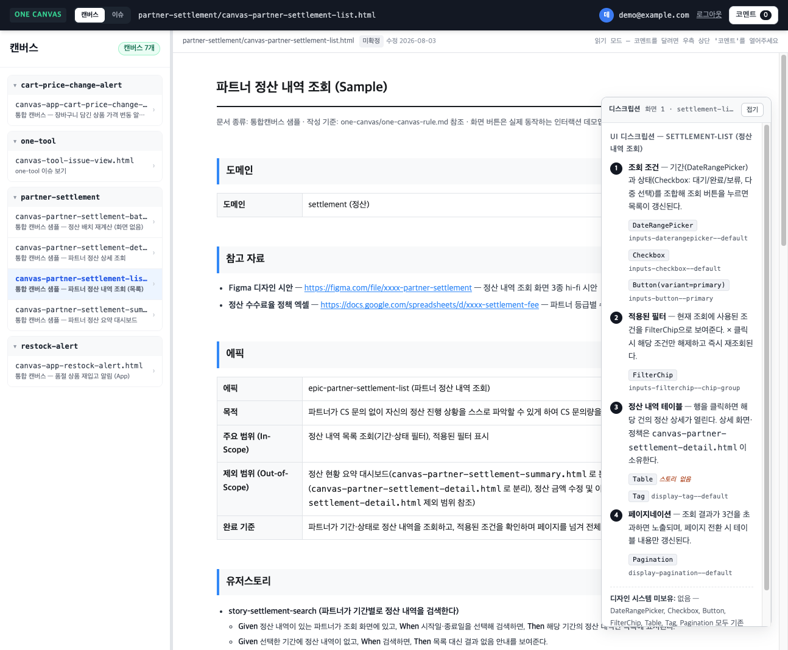

**에픽** — 이 기획이 왜 필요한지, 어디까지 하고 어디부터 안 하는지, 언제 끝난 것인지를 표로 적습니다.

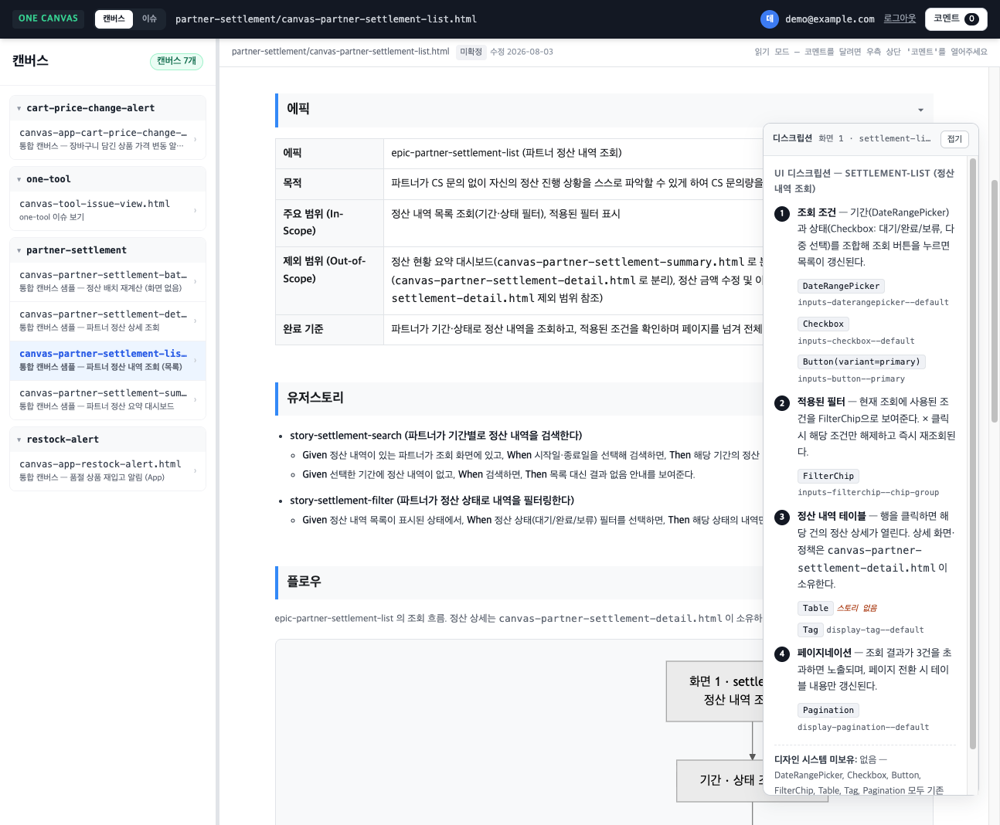

**유저스토리** — 사용자 동작을 Given-When-Then으로 적습니다.

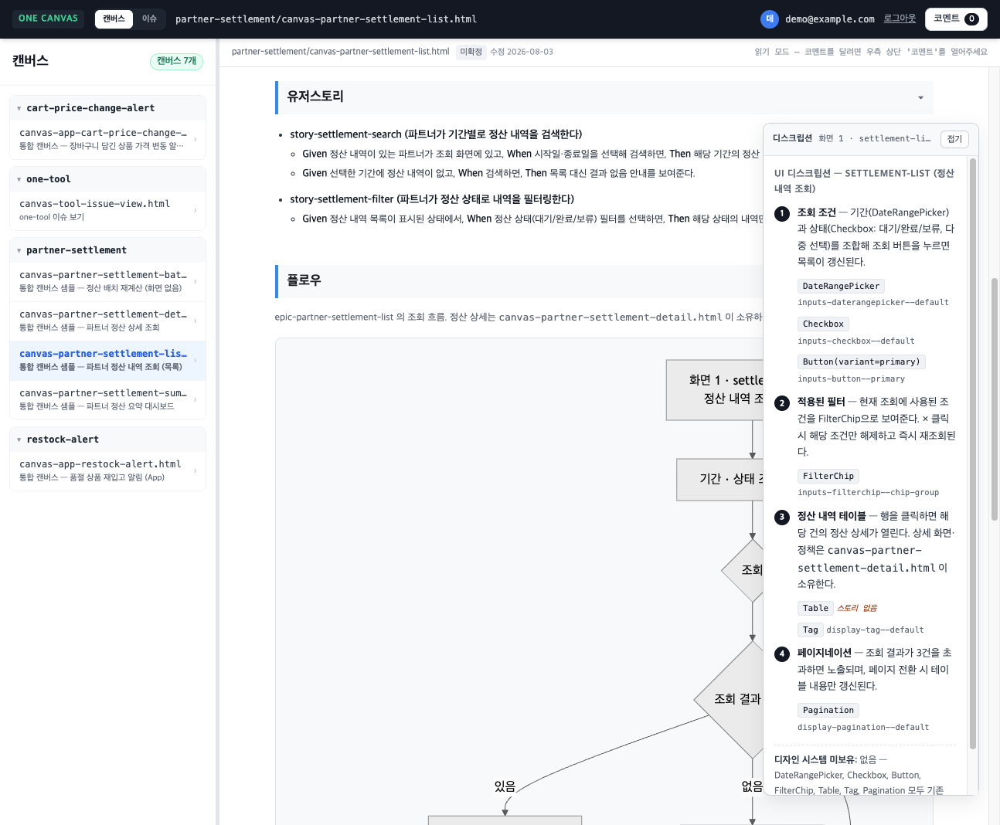

**플로우** — 에픽의 처리 흐름을 다이어그램으로 그립니다. 다른 캔버스가 소유한 화면(여기서는 정산 상세)은 이탈 노드 하나로만 표시합니다.

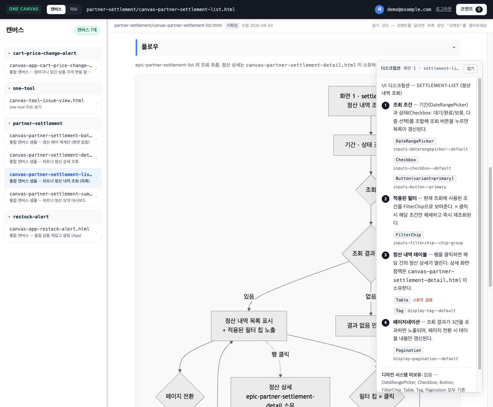

**화면(디자인)** — 번호(①②③④)가 붙은 실제 동작 목업입니다. 오른쪽 패널의 디스크립션과 번호가 1:1로 대응하고, 각 요소가 쓰는 디자인 시스템 컴포넌트가 태깅되어 있습니다.

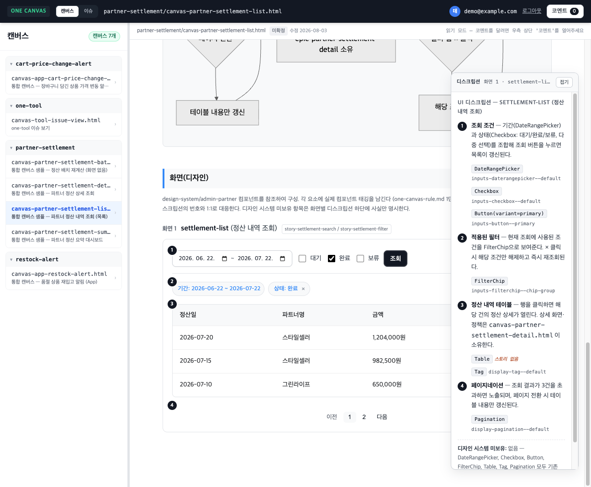

### 3-3. 작성 원칙

- **근거 없는 내용은 지어내지 않고 질문한다.** 캔버스는 뒤따르는 애자일 이슈의 단일 출처라서, 한 줄을 지어내면 에픽·스토리·테스트가 모두 그 전제 위에 쌓입니다.
- **캔버스 1개는 에픽 1개.** 한 기획 건에서 캔버스가 여러 개 나오는 것이 정상이며, 같은 폴더에 모읍니다.
- **디자인 시스템에 있는 컴포넌트만 태깅한다.** 없는 것은 「디자인 시스템 미보유」로 따로 적습니다.

---

## 4. one-tool이란

one-tool은 위의 캔버스와 이슈 문서를 **브라우저에서 열람하고, 캔버스 블록에 코멘트를 남기는** 웹앱입니다 (Spring Boot WebFlux + MySQL). 파일로 관리되는 문서를 서버가 폴더에서 읽어 보여주기 때문에, 레포의 문서를 고치면 화면에도 반영됩니다.

### 4-1. 로그인

이메일·닉네임·비밀번호로 회원가입한 뒤 로그인합니다. 닉네임은 코멘트 작성자 이름으로 표시됩니다.

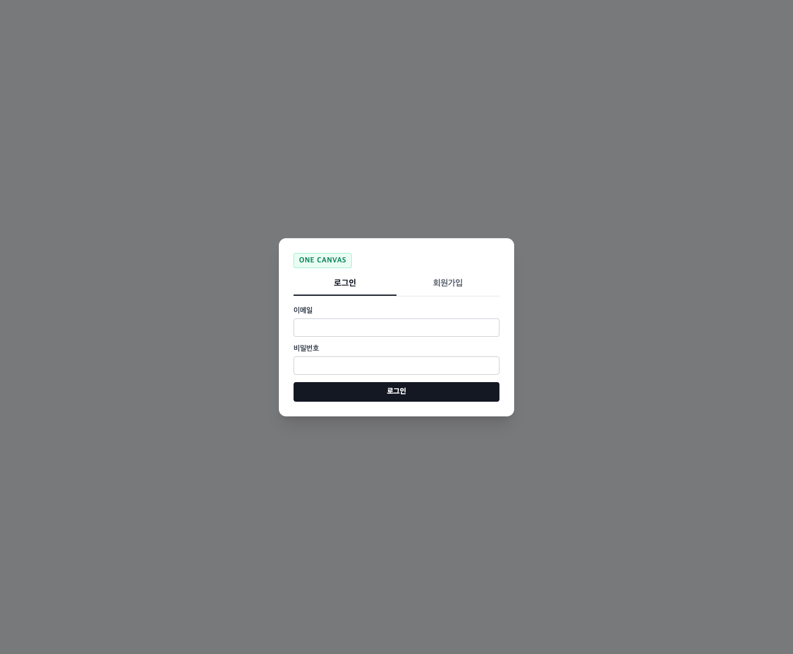

### 4-2. 모드 선택

로그인하면 **캔버스 모드**와 **이슈 모드** 중에서 고릅니다. 각 모드에서 마지막으로 본 문서가 기억되어 「이어서 보기」로 바로 돌아갈 수 있습니다.

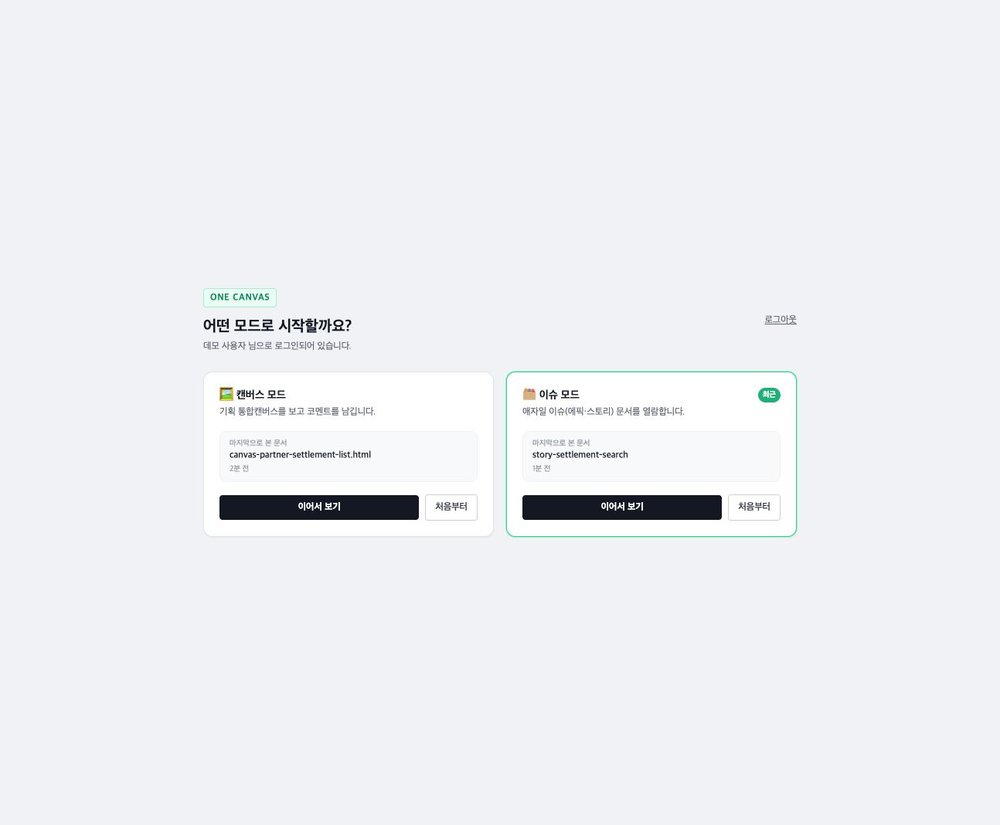

### 4-3. 캔버스 모드

화면은 세 부분입니다.

- 상단 바: 캔버스/이슈 전환, 현재 파일 경로, 로그인 사용자, 코멘트 버튼
- 왼쪽: 기획 건(폴더) 별 캔버스 목록. 파일의 제목이 함께 표시됩니다.
- 본문: 선택한 캔버스. 파일 경로 옆에 **확정/미확정** 배지와 수정일이 보입니다.

기본은 **읽기 모드**입니다.

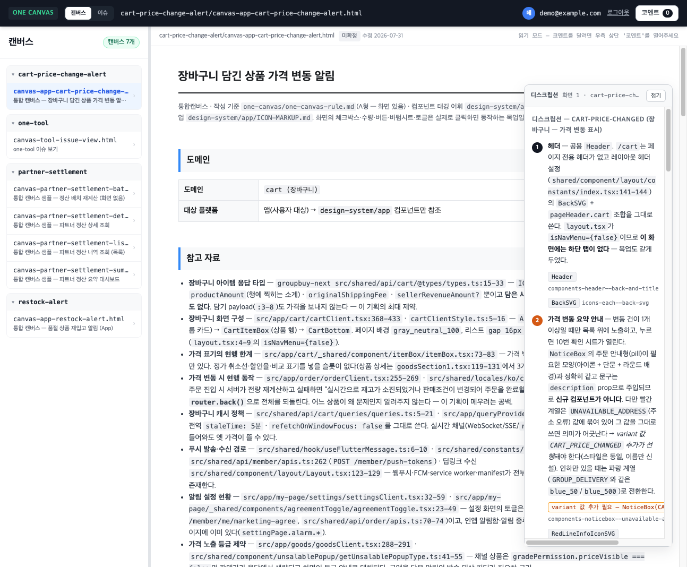

### 4-4. 코멘트

우측 상단의 「코멘트」를 켜면 **코멘트 모드**가 됩니다. 본문 왼쪽에 코멘트 패널이 열리고, 「미해결만 보기」로 필터링할 수 있습니다.

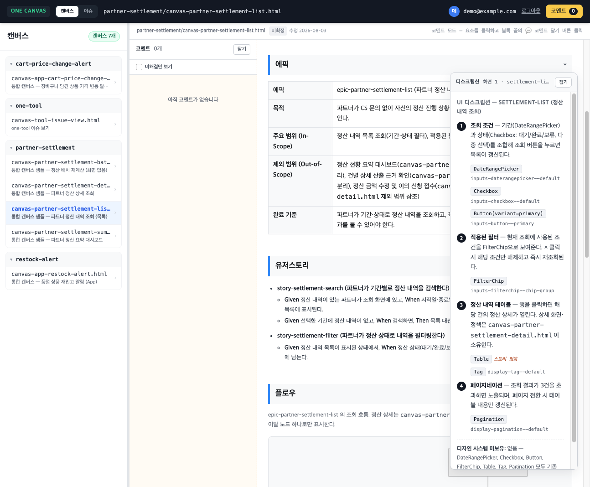

본문의 블록(표의 행, 문단 등)을 클릭하면 선택되고 「💬 코멘트 달기」 버튼이 나타납니다. 선택한 블록이 코멘트에 "지목"으로 함께 기록됩니다.

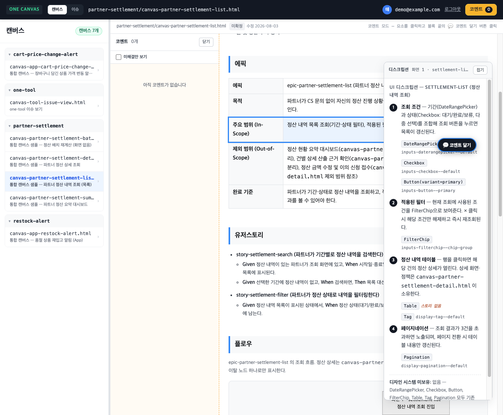

등록하면 패널에 코멘트가 쌓이고, 코멘트가 달린 블록과 왼쪽 목록의 캔버스에 미해결 코멘트 개수가 표시됩니다. 코멘트에는 답글과 해결 표시가 있습니다.

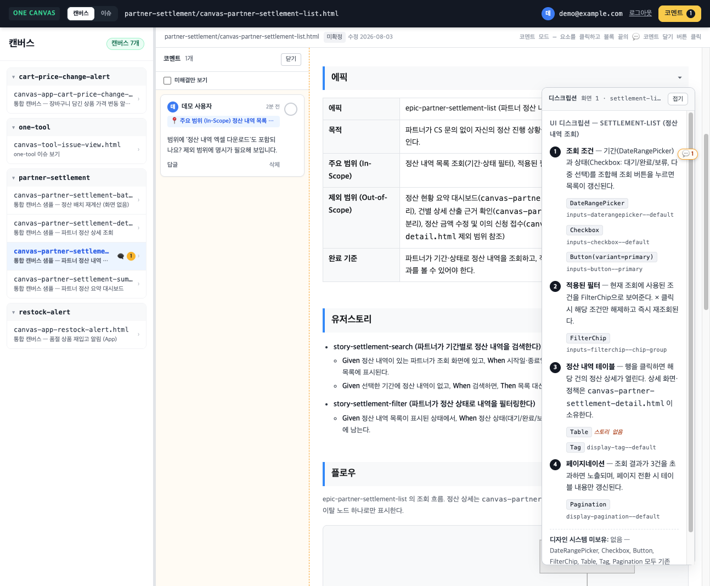

> 코멘트 정보는 캔버스 HTML 파일에 쓰지 않고 one-tool의 DB에 저장합니다. 리뷰 때문에 원본 파일이 바뀌어 작성자와 충돌이 나는 일을 막기 위해서입니다.

### 4-5. 이슈 모드

상단의 「이슈」로 전환하면 레포의 **애자일 이슈 문서**를 열람합니다. 왼쪽에 `도메인 → 에픽 → 스토리` 트리가 있고, 클릭하면 본문에 내용이 나옵니다. **열람 전용**이라 이 화면에서는 수정하지 않습니다.

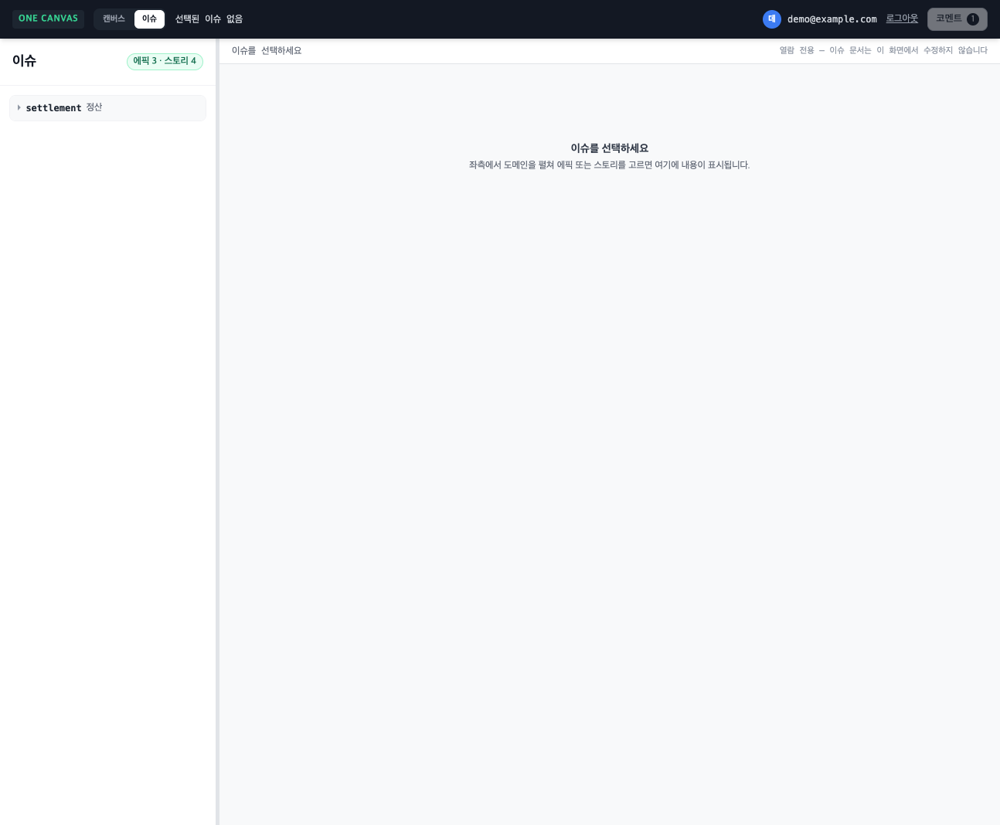

스토리를 열면 상태(draft 등), 설명, **수락 기준(AC)**, **태스크**(Backend/Frontend)가 한 화면에 나옵니다. 태스크에는 어느 AC를 위한 것인지, 캔버스의 어느 화면·컴포넌트(`[ui: 화면1 ①…]`)를 구현하는 것인지가 연결되어 있습니다.

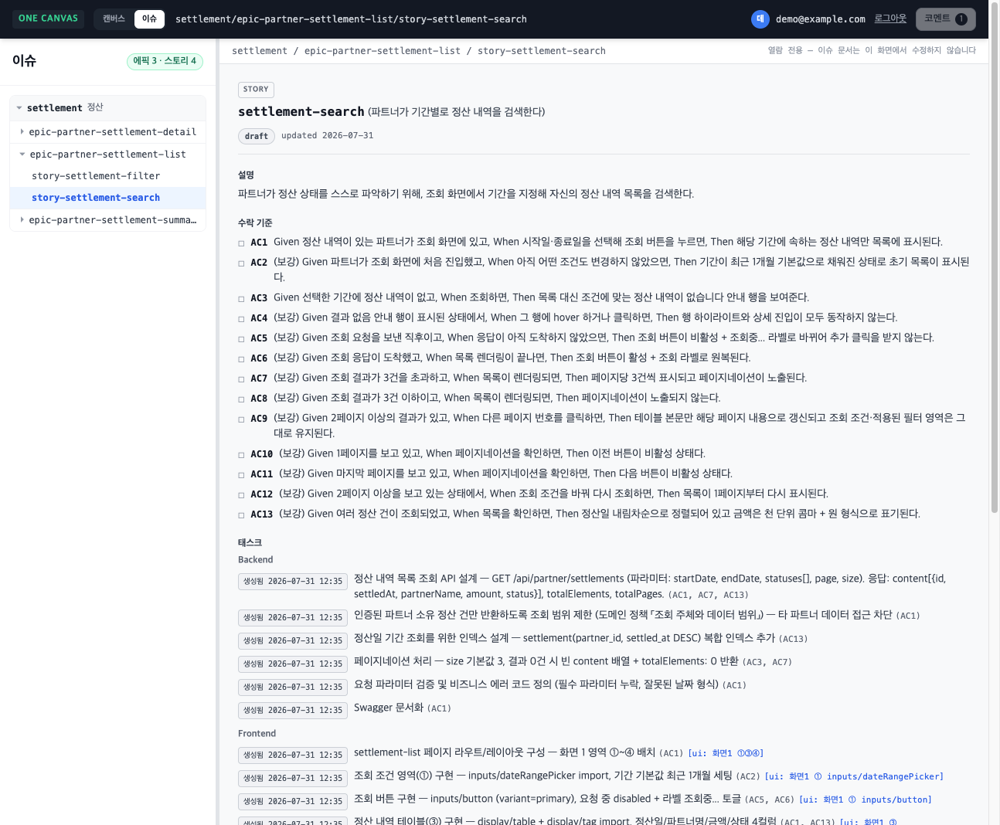

> 이슈 모드에서는 코멘트를 달 수 없습니다. 코멘트는 캔버스 모드의 기능입니다.

---

## 5. 전체 흐름: 기획에서 개발까지

```
기획자: 통합캔버스 초안 작성
   │   (도메인·에픽·유저스토리·플로우·화면·디스크립션)
   ▼
디자이너/리뷰어: one-tool에서 열람하고 블록별 코멘트, AI와 대화하며 수정
   │
   ▼
agile-issue: 캔버스를 근거로 에픽·스토리(수락 기준, 태스크, 테스트) 생성
   │
   ▼
개발: 이슈 + 캔버스 화면 + 디자인 시스템(Storybook) 컴포넌트로 구현
```

수정이 생기면 **영향 범위 파악 → 디자인 시스템 반영 → 이슈 수정 → 개발 수정** 순서로 전파합니다.

캔버스와 이슈는 에픽 문서의 `캔버스:` 줄로 연결됩니다 (예: [`agile-issue/sample/settlement/epic-partner-settlement-list/index.md`](../agile-issue/sample/settlement/epic-partner-settlement-list/index.md)). 이슈 규칙은 [`agile-issue/agile-issue-rule.md`](../agile-issue/agile-issue-rule.md)에 있습니다.

---

## 6. 레포 구성

| 경로 | 내용 |
|---|---|
| `one-canvas/` | 통합캔버스 작성 규칙(`one-canvas-rule.md`)과 샘플 캔버스(`sample/`) |
| `agile-issue/` | 애자일 이슈 작성 규칙(`agile-issue-rule.md`)과 샘플 이슈(`sample/`) |
| `one-tool/` | 캔버스·이슈 열람 및 코멘트 웹앱 (Spring Boot) |
| `docs/` | 이 문서와 캡처 이미지 |

샘플 캔버스:

- `sample/partner-settlement/` — 파트너 정산 (목록·요약·상세·배치 4개 캔버스)
- `sample/cart-price-change-alert/` — 장바구니 가격 변동 알림
- `sample/restock-alert/` — 재입고 알림
- `sample/one-tool/` — one-tool 자체의 이슈 보기 기획

---

## 7. 직접 실행해 보기

### 준비물

- JDK 21
- MySQL 8 (비어 있는 데이터베이스 하나. 테이블은 앱이 시작할 때 `schema.sql`로 만듭니다)

### 주의 1: `sample/` 폴더는 기본적으로 목록에서 빠집니다

one-tool은 캔버스·이슈 목록을 만들 때 **`sample` 폴더를 제외**합니다. 이 레포에는 샘플만 있으므로 그대로 띄우면 캔버스 0개, 이슈 0개로 보입니다. 샘플 내용을 한 단계 위로 복사한 폴더를 만들어 그 경로를 지정하세요.

```bash
mkdir -p /tmp/demo/one-canvas /tmp/demo/agile-issue
cp -R one-canvas/sample/*  /tmp/demo/one-canvas/
cp -R agile-issue/sample/* /tmp/demo/agile-issue/
```

### 주의 2: DB 비밀번호에는 기본값이 없습니다

`DB_PASSWORD`를 주지 않으면 시작 단계에서 바로 실패합니다.

### 실행

```bash
# 예: 로컬에 일회용 MySQL 띄우기
docker run -d --name onetool-mysql -e MYSQL_ROOT_PASSWORD=changeme \
  -e MYSQL_DATABASE=one-tool -p 3307:3306 mysql:8.3 --character-set-server=utf8mb4

cd one-tool
./gradlew bootJar -x test
java -jar build/libs/one-tool-0.0.1-SNAPSHOT.jar \
  --server.port=8090 \
  --spring.datasource.url='jdbc:mysql://127.0.0.1:3307/one-tool?characterEncoding=utf8' \
  --spring.datasource.username=root \
  --spring.datasource.password=changeme \
  --one-canvas.root-path=/tmp/demo/one-canvas \
  --agile-issue.root-path=/tmp/demo/agile-issue
```

브라우저에서 `http://localhost:8090`을 열고 **회원가입 → 로그인**하면 됩니다.

> 참고: 소스에는 앱 시작 시 기본 계정을 하나 만드는 코드가 있습니다(`MemberService`). 공개 환경에 배포하기 전에 이 시드 계정과 비밀번호는 반드시 제거하세요.
