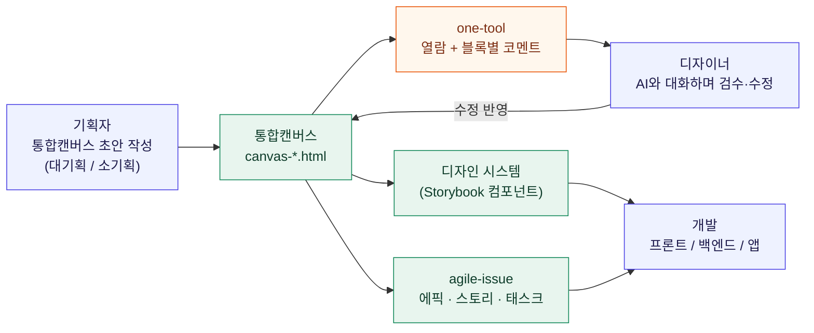
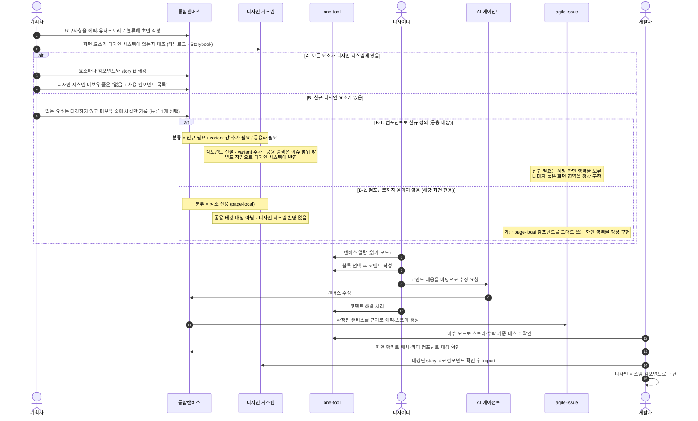
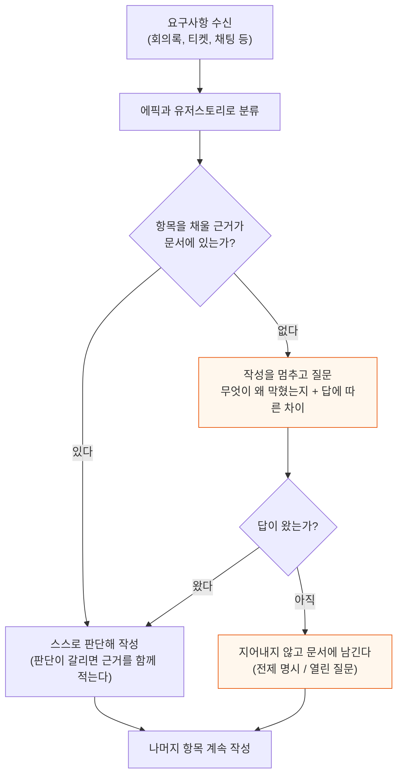
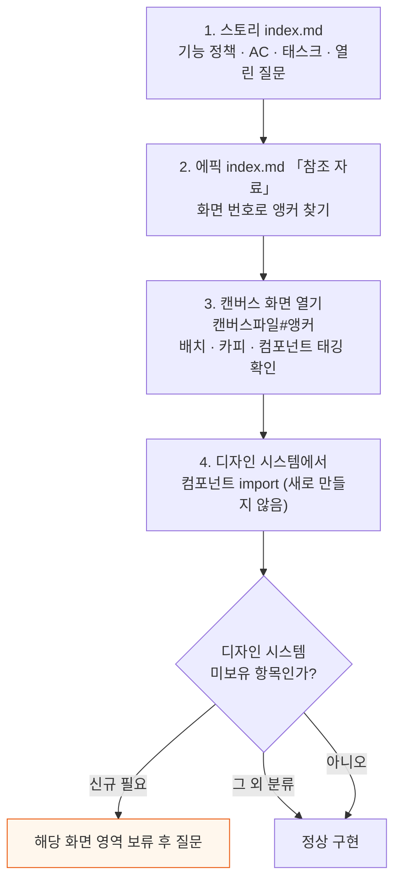
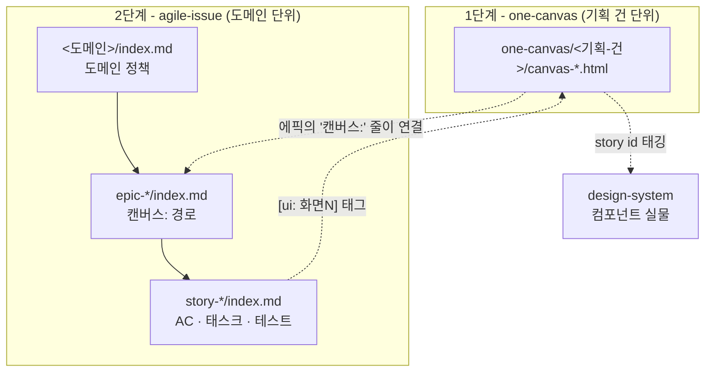

# one-canvas 업무 프로세스

기획에서 개발까지 one-canvas가 어떻게 흘러가는지 도식으로 정리한 문서입니다. GitHub에서 Mermaid가 바로 렌더링됩니다.
각 도식의 근거는 [`one-canvas-rule.md`](../one-canvas/one-canvas-rule.md), [`agile-issue-rule.md`](../agile-issue/agile-issue-rule.md)와 레포 README입니다.

## 1. 전체 흐름

기획자가 통합캔버스 초안을 쓰면, 디자이너가 one-tool에서 보고 코멘트하며 AI와 함께 검수·수정합니다. 확정된 캔버스는 디자인 시스템과 애자일 이슈로 이어져 개발로 갑니다.

## 2. 담당별 단계 (시퀀스)

기획 단계에서 화면의 디자인 요소를 **디자인 시스템과 대조**하는 것이 갈림길입니다. 모든 요소가 이미 있으면 그대로 태깅하고, 신규 디자인이 있으면 그것을 **컴포넌트로 정의할지, 컴포넌트까지 올리지 않을지**에 따라 처리가 달라집니다.

### 경우별 정리

| 경우 | 캔버스에 적는 것 | 디자인 시스템 | 화면 영역 구현 |
|---|---|---|---|
| **A. 모두 포함** | 컴포넌트 이름 + story id 태깅, 미보유 줄은 "없음" | 변경 없음 | 정상 |
| **B-1. 신규 정의 · 신규 필요** | 태깅하지 않고 `신규 필요: 이름` 기록 | 컴포넌트 신설은 별도 작업 | **보류하고 질문** |
| **B-1. 신규 정의 · variant 값 추가 필요** | `variant 값 추가 필요: 컴포넌트(값)` 기록 | 값 이름만 추가(신규 컴포넌트 아님) | 정상 (컴포넌트가 이미 있음) |
| **B-1. 신규 정의 · 공용화 필요** | `공용화 필요 — 위치 / 컴포넌트` 기록 | 다른 화면 전용 컴포넌트를 공용으로 승격 | 정상 (현재 위치의 컴포넌트를 재사용하는 전제) |
| **B-2. 컴포넌트까지 올리지 않음** | `참조 전용(page-local): 이름` 기록 | 변경 없음 | 정상 |

지켜야 할 원칙은 아래와 같습니다.

- 캔버스는 **사실만 보고한다.** 미보유 줄에 "디자인 시스템에 편입하자"는 권유를 섞지 않습니다. 편입 여부는 캔버스가 아니라 별도로 판단합니다.
- 디자인 시스템에 없는 컴포넌트를 **있는 것처럼 태깅하지 않습니다.**
- 애자일 이슈는 디자인 시스템 쪽 작업(컴포넌트 신설·variant 추가·공용화)을 **태스크로 만들지 않습니다.**
- 화면 영역까지 보류하는 것은 `신규 필요` 한 가지뿐입니다. 나머지 분류는 화면의 수락 기준·태스크·테스트를 정상적으로 둡니다.

## 3. 캔버스 작성 시 판단 규칙 (지어내지 않고 질문한다)

캔버스는 뒤따르는 이슈의 단일 출처입니다. 근거가 없는 항목은 채우지 않고 질문합니다.

질문 없이 하면 안 되는 대표 행동은 아래와 같습니다.

- 빈칸을 그럴듯한 문장으로 채우기
- `TBD`만 적고 넘어가기
- 디자인 시스템에 없는 컴포넌트를 있는 것처럼 태깅하기

## 4. 개발 착수 절차 (화면이 있는 스토리)

문서 하나만 읽고 착수하지 않습니다. 같은 화면에 대한 정보가 문서마다 나뉘어 있기 때문입니다.

화면 없는 스토리(B유형)는 2~4를 건너뛰고, 에픽의 「흐름도」가 처리 순서와 분기의 단일 출처가 됩니다.

## 5. 변경이 생기면

수정은 아래 순서로 전파됩니다. 캔버스가 항상 최신이어야 하는 이유입니다.

## 6. 문서 간 연결 관계

1단계는 기획 건(폴더) 단위, 2단계는 도메인 단위로 묶이며, 둘을 잇는 것은 폴더가 아니라 에픽의 `캔버스:` 줄입니다.
